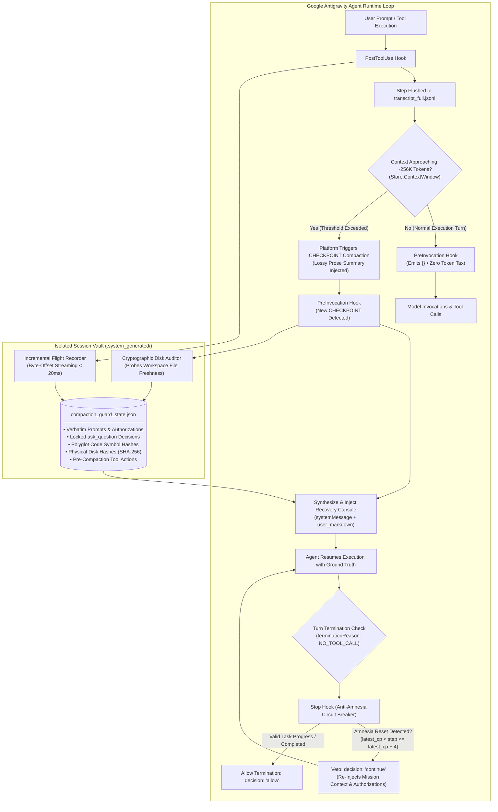
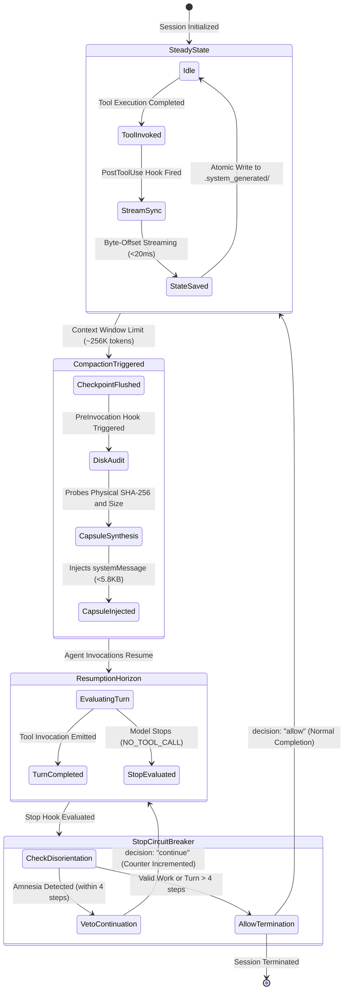

<p align="center">
  
</p>

<h1 align="center">Antigravity Compaction Guard</h1>

<p align="center">
  <strong>Deterministic lifecycle hook engine for Google Antigravity (<code>agy</code>) that prevents agent context amnesia, preserves modified code symbols, and verifies physical disk state across auto-compaction checkpoints.</strong>
</p>

<p align="center">
  <a href="https://github.com/mhdalijawara-cloud/antigravity-compaction-guard/actions/workflows/ci.yml"></a>
  <a href="https://github.com/mhdalijawara-cloud/antigravity-compaction-guard/releases"></a>
  <a href="https://www.npmjs.com/package/antigravity-compaction-guard"></a>
  <a href="LICENSE"></a>
  <a href="plugin.json"></a>
  <a href="https://www.python.org/"></a>
</p>

<p align="center">
  <a href="#background">Overview</a> •
  <a href="#architecture">Architecture</a> •
  <a href="#core-capabilities">Core Capabilities</a> •
  <a href="#recovery-capsule-anatomy">Capsule Anatomy</a> •
  <a href="#installation">Installation</a> •
  <a href="#diagnostics-and-testing">Diagnostics & Testing</a> •
  <a href="#specifications">Specifications</a> •
  <a href="#security--privacy-guarantees">Security & Privacy</a>
</p>

---

## Background

When an Antigravity conversation trajectory approaches its context boundary (~256K tokens, defined in `Store.ContextWindow()`), the platform triggers a **checkpoint compaction**:

1. **Loss of Code Symbol Context:** Raw tool outputs and syntax structures are collapsed into lossy prose summaries, removing exact function signatures, class interfaces, and schema definitions from active memory.
2. **"File Still in Memory" Hallucination:** The checkpoint summary frequently claims previously modified files remain available in working memory. The agent assumes it retains exact file contents, avoids reading from disk, and applies misaligned edits.
3. **Mid-Session Re-Bootstrapping:** Agents often lose session continuity post-compaction, emitting generic onboarding greetings (*"How can I help you today?"*) or asking to re-confirm roles, tasks, and project scopes mid-flight.

> [!NOTE]
> Because native `PreCompact` and `PostCompact` hooks are not yet exposed by the platform (upstream feature request `#1317`), compaction cannot be intercepted beforehand. Compaction Guard provides a deterministic continuous recorder and post-checkpoint ground truth enforcement layer to resolve these limitations with **zero token overhead** during normal execution turns.

---

## Architecture

Compaction Guard operates as an asynchronous, deterministic lifecycle security fabric integrated directly into Google Antigravity's agent loop. Because auto-compaction collapses conversational state into lossy prose summaries, Compaction Guard establishes an independent, write-isolated ground truth ledger that persists across compaction boundaries.

### 1. End-to-End System Flowchart



### 2. Multi-Layer Subsystem Architecture

Compaction Guard is decomposed into four discrete, decoupled subsystems:

| Layer | Subsystem | File / Interface | Architectural Responsibility |
| :--- | :--- | :--- | :--- |
| **L1** | **Interception Fabric** | [hooks.json](file:///C:/Users/Pongo/.gemini/config/plugins/compaction-guard/hooks.json) | Mounts native lifecycle hooks (`PostToolUse`, `PreInvocation`, `Stop`) with zero token overhead during regular execution turns. |
| **L2** | **Continuous Flight Recorder** | [compaction_guard.py](file:///C:/Users/Pongo/.gemini/config/plugins/compaction-guard/scripts/compaction_guard.py) (`post-tool`) | Tails `transcript_full.jsonl` using buffered `O(1)` byte-offset streaming (`< 20 ms`). Resilient to partial EOF line writes. Extracts polyglot code symbols, user authorizations, and disk hashes into `.system_generated/compaction_guard_state.json`. |
| **L3** | **Cryptographic State Rehydrator** | [compaction_guard.py](file:///C:/Users/Pongo/.gemini/config/plugins/compaction-guard/scripts/compaction_guard.py) (`pre-invocation`) | Single-shot checkpoint interceptor. Probes physical disk files (12-char SHA-256 + byte size), formats the ~5,800-character Ground-Truth Recovery Capsule, and injects it via native `systemMessage`. |
| **L4** | **Anti-Amnesia Circuit Breaker & Directive** | [compaction_guard.py](file:///C:/Users/Pongo/.gemini/config/plugins/compaction-guard/scripts/compaction_guard.py) (`stop`) & [rules/AGENTS.md](file:///C:/Users/Pongo/.gemini/config/plugins/compaction-guard/rules/AGENTS.md) | Single-shot circuit breaker per checkpoint preventing new-session role queries within the post-compaction horizon (`latest_cp < step <= latest_cp + 4`). Enforces disk re-verification (`Freshness`) before modifying previously edited files. |

### 3. State Machine & Execution Lifecycle

Compaction Guard models agent execution as a deterministic finite-state machine (FSM) with five core states and strict mathematical invariants ensuring zero-overhead steady-state execution and single-shot fault recovery:



#### State Transition Matrix

| Current State | Stimulus / Event | Guard Condition | Next State | Action & Emitted Payload |
| :--- | :--- | :--- | :--- | :--- |
| **`STEADY_STATE`** | Tool execution completes | Normal turn (no new checkpoint) | **`STREAM_SYNC`** | `PostToolUse` fires; tails `transcript_full.jsonl` from current byte offset. Emits `{}`. |
| **`STREAM_SYNC`** | JSONL lines parsed | EOF reached cleanly | **`STEADY_STATE`** | Atomically writes `compaction_guard_state.json`. Emits `{}` (0 token tax). |
| **`STEADY_STATE`** | Context exceeds ~256K tokens | Platform triggers compaction | **`COMPACTION_TRIGGERED`** | Antigravity engine appends `CHECKPOINT` step to transcript. |
| **`COMPACTION_TRIGGERED`** | Next agent invocation begins | `latest_cp > last_injected` | **`CAPSULE_REHYDRATION`** | `PreInvocation` hook fires; audits modified workspace files on disk (12-char SHA-256 + size). |
| **`CAPSULE_REHYDRATION`** | Recovery capsule synthesized | Capsule length `<= 5,800` characters | **`RESUMPTION_HORIZON`** | Injects single-shot `systemMessage` with `metadata.user_markdown`. Updates `last_injected = latest_cp`. |
| **`RESUMPTION_HORIZON`** | Model finishes turn | `terminationReason == NO_TOOL_CALL` | **`CIRCUIT_BREAKER_EVAL`** | `Stop` hook triggers for amnesia evaluation. |
| **`CIRCUIT_BREAKER_EVAL`** | Model emits role query or greeting | `latest_cp < step <= latest_cp + 4` AND `blocks < 1` AND `has_tools == False` | **`RESUMPTION_HORIZON`** | Emits `decision: "continue"` with orientation veto prompt. Increments `blocks_map[latest_cp]`. |
| **`CIRCUIT_BREAKER_EVAL`** | Model produces work or exits | `step > latest_cp + 4` OR `blocks >= 1` OR `has_tools == True` | **`STEADY_STATE`** | Emits `decision: "allow"`. Turn completes normally. |

#### Deterministic Lifecycle Invariants

1. **Zero-Overhead Steady State:** Normal turns without compactions always emit `{}` (0 tokens added to context window).
2. **Single-Shot Idempotency:** A `CHECKPOINT` triggers ground-truth recovery capsule injection at most once per compaction event (`N_injections <= 1`).
3. **Anti-Infinite-Loop Guarantee (`O(1)` Continuation Bound):** The circuit breaker strictly bounds continuation vetoes to at most one per checkpoint event (`N_veto <= 1`):
   - **Trigger Guard:** A veto is permitted if and only if `blocks_map[cp_key] == 0`. Upon emitting a veto, the state counter is atomically incremented to `1`.
   - **Deterministic Fallback:** If the agent fails to self-orient and repeats an amnesia query on the subsequent turn, the guard check (`already_blocked < 1`) evaluates to `False`, forcing the hook to unconditionally return `decision: "allow"`.
   - **Infinite Loop Immunity:** The agent loop is guaranteed to terminate within `<= 1` re-entry attempt, safely escalating the prompt to the user rather than risking an unbounded execution or quota-draining loop. Independent counter buckets (`cp_key = str(latest_cp)`) ensure subsequent compactions later in the session retain their own isolated one-shot protection.
4. **Resumption Horizon Boundary:** Disorientation intercepts are restricted strictly to the immediate post-compaction horizon (`latest_cp < resp_step <= latest_cp + 4`), eliminating false-positive blocks during later task completion.
5. **Physical Ground-Truth Verification:** File probe statuses (`DISK_OK` vs `MISSING_ON_DISK`) are computed live against physical disk state, immunizing the agent against hallucinated memory summaries.

---

## Core Capabilities

### 1. Continuous Flight Recorder (`PostToolUse`)
- Incrementally tails `transcript_full.jsonl` using buffered byte-offset streaming (`< 20 ms`, `O(1)` memory).
- Tolerates partial line writes at EOF during concurrent logging without offset desynchronization.
- **Polyglot Code Symbol Extraction:** Extracts modified top-level and member definitions across:
  - **Python:** `class`, `def`, `async def`
  - **TypeScript & JavaScript:** `interface`, `type`, `class`, `export const fn: Type = () =>`, `function*`
  - **Rust:** `pub struct`, `pub fn`, `pub async fn`, `pub(crate) trait`, `pub enum`
  - **Go:** `type Struct struct`, `func (s *Receiver) Method()`, `func Function()`
  - **Java & C#:** `public class`, `abstract class`, `interface`, methods, and namespaces
- **Physical Disk Hashes:** Computes 12-character SHA-256 and byte sizes of modified files (skips binary files > 64 MB). File probing strictly prioritizes workspace paths to prevent directory collisions.
- **State Isolation:** State is persisted exclusively inside `.system_generated/compaction_guard_state.json` within the session artifact directory—never polluting user workspace files.

### 2. Zero-Overhead Ground-Truth Rehydration (`PreInvocation`)
- Emits `{}` (`0` tokens) during normal turns.
- When a new `CHECKPOINT` is detected, injects an authoritative `systemMessage` Ground-Truth Recovery Capsule once per compaction event.
- Strictly bounded within an enforced token budget (~5,800 characters / < 1,200 tokens) to prevent context bloat:
  - Verbatim initial and recent user requests and authorizations.
  - Locked `ask_question` decision specifications (preserves multi-line user choices).
  - Mutated files ledger with live disk verification status (`DISK_OK` vs `MISSING_ON_DISK`) and modified code symbols.
  - Tool actions executed immediately prior to compaction.

### 3. Mid-Session Amnesia Circuit Breaker (`Stop`)
- **Single-Shot per Checkpoint (`N_veto <= 1`):** Strictly bounds continuation vetoes to at most 1 attempt per compaction event. If the model repeats an amnesia query on the second turn, the hook unconditionally yields `decision: "allow"` to eliminate infinite execution loops.
- **Immediate Disorientation Horizon:** Intercepts onboarding greetings (*"How can I help you today?"*, *"Apa peran saya pada sesi ini?"*) strictly when emitted within the immediate resumption window (`latest_cp < resp_step <= latest_cp + 4`).
- **Context Re-Orientation:** Emits `decision: "continue"` with an authoritative orientation prompt reminding the agent of active tasks, granted authorizations, and disk re-verification mandates.
- **False-Positive Immunity:** Turns occurring > 4 steps past the checkpoint or turns that executed actual tools (`has_tools == True`) are never blocked, allowing normal task completion and legitimate sign-offs.

### 4. Transcript Runway Telemetry
- Monitors raw transcript byte growth and emits real-time status indicators:
  - `NORMAL`: `< 650 KB`
  - `WARNING`: `650 KB - 720 KB` (~220K tokens)
  - `CRITICAL`: `> 720 KB` (~245K tokens; auto-compaction imminent)

---

## Recovery Capsule Anatomy

When compaction occurs, Compaction Guard constructs and injects a structured recovery capsule into the agent context:

```markdown
[COMPACTION GUARD RECOVERY CAPSULE — AUTHORITATIVE GROUND TRUTH]
Auto-compaction (`CHECKPOINT`) occurred at step 42. This is an ACTIVE ONGOING SESSION, NOT a brand-new session.
MANDATORY CONTINUITY RULES:
1. DO NOT execute new-session role bootstrap questions or startup greetings.
2. DO NOT invalidate or re-ask for role assignments or work authorizations already granted below.
3. Before resuming any code/file edit, call `read_file` on modified target files below to re-verify exact current lines on disk (`Freshness`).
4. Full untruncated log remains on disk if exact line details are needed: `<transcript_path>`.

## Verbatim User Requests & Active Authorizations
- [Initial step 0] Refactor payment service and migrate database schema to PostgreSQL. Autonomous execution approved.
- [step 38] Proceed with indexing on transactions table.

## Locked Specifications (`ask_question` Decisions)
- [Resolved at step 4]:
  - Q: Select target database backend?
    A: A1: PostgreSQL -> Production PostgreSQL cluster

## Files Modified in This Session (Re-Read Before Further Edits)
- `src/db/schema.py` (edits=3, last_step=40, DISK_OK size=4096B sha256=a1b2c3d4e5f6, symbols: PaymentTable, create_indexes)
- `src/services/payment.py` (edits=2, last_step=36, DISK_OK size=8192B sha256=f6e5d4c3b2a1, symbols: PaymentService, process_charge)

## Last Tool Actions Immediately Before Compaction
- [step 39] `read_file` -> path=src/db/schema.py:1-120
- [step 40] `edit_file` -> path=src/db/schema.py
```

---

## Installation

### Automated Installer (Recommended)

Run the zero-install setup directly via NPX:

```bash
# Global installation into ~/.gemini/config/plugins/compaction-guard [default]
npx antigravity-compaction-guard

# Workspace-local installation into .agents/plugins/compaction-guard
npx antigravity-compaction-guard --workspace

# Verify existing installation without re-copying files
npx antigravity-compaction-guard --verify
```

### Git Clone (Manual)

```bash
# Global installation (User level)
git clone https://github.com/mhdalijawara-cloud/antigravity-compaction-guard.git ~/.gemini/config/plugins/compaction-guard

# Workspace installation (Project level)
git clone https://github.com/mhdalijawara-cloud/antigravity-compaction-guard.git .agents/plugins/compaction-guard
```

> [!TIP]
> Antigravity automatically detects and loads plugins placed in either `~/.gemini/config/plugins/` (global) or `.agents/plugins/` (workspace-local) upon agent launch. No manual environment variable exports are required.

---

## Hook Lifecycle Mapping

Compaction Guard hooks are registered in [hooks.json](file:///C:/Users/Pongo/.gemini/config/plugins/compaction-guard/hooks.json):

| Lifecycle Hook | Matcher / Target | Engine Responsibility |
| :--- | :--- | :--- |
| **`PostToolUse`** | All tools (`""`) | Incremental flight recorder tails transcript, extracts code symbols, and records physical disk hashes. |
| **`PreInvocation`** | Model invocation | Checks for unhandled `CHECKPOINT` events. Emits `{}` on normal turns; injects recovery capsule on compaction. |
| **`Stop`** | `NO_TOOL_CALL` termination | Single-shot circuit breaker intercepts new-session startup greetings or role re-prompting emitted post-compaction. |

---

## Diagnostics and Testing

```bash
# Run the test suite (21 unit & adversarial tests with mock JSONL transcripts)
python ./scripts/test_compaction_guard.py -v

# Inspect session state, runway meter, and recovery capsule for any active transcript:
# (From repository root)
python ./scripts/compaction_guard.py inspect "<path-to-transcript.jsonl>"

# (From any workspace globally)
python ~/.gemini/config/plugins/compaction-guard/scripts/compaction_guard.py inspect "<path-to-transcript.jsonl>"

# Print engine version
python ./scripts/compaction_guard.py --version

# Run installer self-test verification
node ./bin/install.js --verify
```

---

## Specifications

| Property | Specification |
| :--- | :--- |
| **Normal Turn Overhead** | `0 tokens` (emits `{}`) |
| **Capsule Token Budget** | `< 1,200 tokens` (~5,800 characters maximum) |
| **Execution Latency** | `< 20 ms` per hook invocation |
| **Runtime Dependencies** | None (Python 3.10+ standard library only) |
| **Installer Dependencies** | Node.js 16.0.0+ (optional; only for NPX installer) |
| **Platform Compatibility** | Linux, macOS, Windows (native shell & path canonicalization) |
| **Tested Environment** | Google Antigravity 2.0 (v2.29.0+) |

---

## Security & Privacy Guarantees

- **100% Offline & Local:** Zero external network connections, zero analytics, zero telemetry collection.
- **Pure Standard Library:** Built exclusively on Python's standard library (`hashlib`, `json`, `pathlib`, `re`). No untrusted third-party pip dependencies.
- **Zero Workspace Pollution:** Internal state and run logs are quarantined strictly inside hidden `.system_generated/` folders.
- **Fail-Safe Fault Tolerance:** Hook exceptions are logged to `.system_generated/compaction_guard_error.log` and return safe fallback payloads (`{}` or `decision: "allow"`), ensuring an engine glitch never breaks or freezes the user's conversation session.

---

## License

[MIT License](LICENSE) — Copyright (c) 2026 Muhammad Ali Jawara Wiratama
